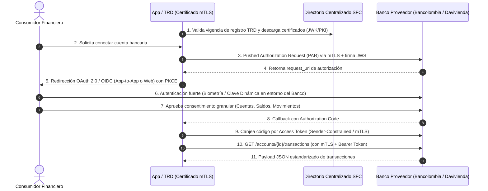
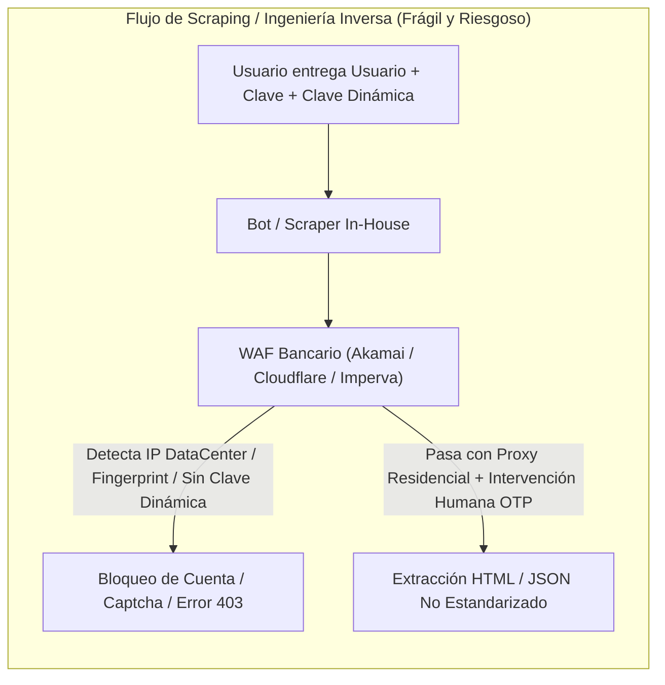
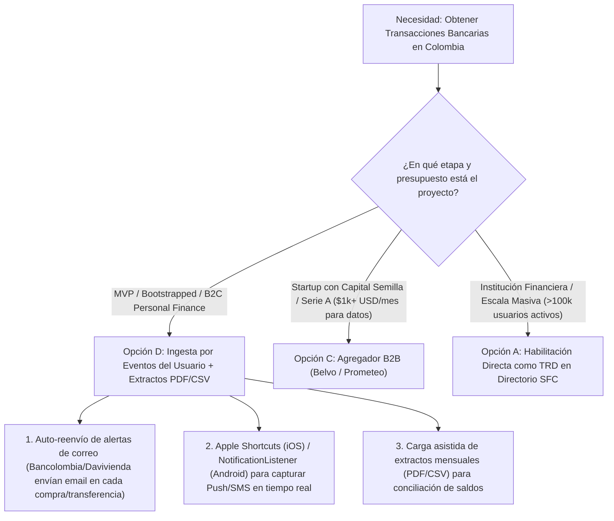

# Investigación Profunda: Convertirse en Agregador Bancario (Open Finance) en Colombia vs. Alternativas de Integración

Este documento presenta un análisis técnico, legal, regulatorio y arquitectónico sobre lo que implica convertirse en un **Agregador Bancario / Tercero Receptor de Datos (TRD)** bajo el marco de **Finanzas Abiertas (*Open Finance*) en Colombia**, en contraste con construir un motor de extracción propio (*in-house scraping*), consumir un agregador B2B existente o implementar ingesta impulsada por eventos del lado del usuario.

---

## 1. Marco Regulatorio y Legal en Colombia (Finanzas Abiertas / Open Finance)

Colombia ha evolucionado de un esquema voluntario a un ecosistema de **Finanzas Abiertas obligatorio** y altamente supervisado por la **Superintendencia Financiera de Colombia (SFC)** y el **Ministerio de Hacienda y Crédito Público (MHCP)**.

### 1.1 Hitos Normativos Clave

| Norma | Entidad Emisora | Alcance e Impacto Técnico/Legal |
| :--- | :--- | :--- |
| **Decreto 1297 de 2022** | Ministerio de Hacienda | Modificó el Decreto 2555 de 2010. Creó el marco jurídico del *Open Finance*, reguló el tratamiento de datos con autorización expresa, habilitó la comercialización de infraestructura y creó formalmente la figura de **Iniciación de Pagos**. |
| **Circular Externa 004 de 2024** | Superintendencia Financiera (SFC) | Adicionó el Capítulo IX al Título I de la Parte I de la Circular Básica Jurídica. Definió los estándares tecnológicos, de arquitectura, ciberseguridad, interoperabilidad y gobierno de datos para las entidades vigiladas y **Terceros Receptores de Datos (TRD)**. |
| **Decreto 0368 de 2026** | Ministerio de Hacienda | En cumplimiento del Plan Nacional de Desarrollo, **eliminó el carácter voluntario** y convirtió el modelo de Finanzas Abiertas en **obligatorio** para las entidades vigiladas por la SFC, consolidando el **Directorio Centralizado de Participantes**. |
| **Leyes 1266 de 2008 y 1581 de 2012** | Congreso de la República | Régimen de *Habeas Data* financiero y protección de datos personales. Exigen que todo acceso a datos transaccionales cuente con autorización previa, expresa e informada. |

### 1.2 Figuras del Ecosistema: TRD vs. SIP

1. **Tercero Receptor de Datos (TRD) — Equivalente a *AISP (Account Information Service Provider)*:**
   - **Definición:** Persona jurídica (vigilada o no vigilada por la SFC, como una Fintech o startup) que accede a los datos personales y transaccionales del consumidor financiero custodiados por una entidad proveedora de datos (ej. Bancolombia, Davivienda).
   - **Supervisión y Debida Diligencia:** Si el TRD **no es una entidad vigilada por la SFC**, la Circular Externa 004 de 2024 traslada la obligación de verificación a las entidades financieras proveedoras de datos y al **Directorio Centralizado** administrado bajo lineamientos de la SFC. Los bancos están obligados a auditar y exigir que el TRD cumpla con los estándares de ciberseguridad y gestión de riesgos antes de otorgarle credenciales de producción.
   - **Requisitos Societarios y de Capital:** Aunque un TRD puro (solo lectura de datos) no requiere constituirse como Establecimiento de Crédito ni tiene el capital mínimo regulatorio de un banco o SEDPE, **sí debe estar constituido como persona jurídica formal** (ej. S.A.S. en Colombia), contar con pólizas de responsabilidad civil y cibernética exigidas en los convenios bilaterales/directorio, Oficial de Cumplimiento/Seguridad de la Información y políticas SARLAFT/SAGRILAFT según el alcance del negocio.

2. **Iniciador de Pagos (SIP) — Equivalente a *PISP (Payment Initiation Service Provider)*:**
   - **Definición:** Tercero que ordena una transferencia de recursos o pago en nombre del consumidor desde su cuenta bancaria, conectándose con Sistemas de Pagos de Bajo Valor (SPBV) y el ecosistema interoperable **Bre-B** del Banco de la República.
   - **Restricción Absoluta:** Bajo el Decreto 1297 de 2022, los iniciadores de pagos **bajo ninguna circunstancia pueden captar, administrar, custodiar o entrar en tenencia de los dineros**. Su rol es exclusivamente tecnológico para disparar la orden autenticada.

> [!IMPORTANT]
> **Estándar del Consentimiento Transaccional (Circular Externa 004 de 2024):** En Colombia, el consentimiento para Open Finance no es un simple *checkbox* en los Términos y Condiciones de tu aplicación. Debe ser un **objeto transaccional auditable** que especifique: (1) qué datos exactos se comparten, (2) para qué finalidad exclusiva, (3) por cuánto tiempo (vigencia temporal limitada), (4) si habrá comercialización de los datos, y (5) un mecanismo inmediato de revocación tanto en el TRD como en el banco.

---

## 2. Estándares Técnicos, Certificaciones y Portales Bancarios Directos

La arquitectura técnica exigida por la SFC y adoptada por la banca colombiana sigue los perfiles británicos y brasileños de Open Finance, basados en seguridad de grado financiero.

### 2.1 Certificaciones y Protocolos Exigidos para Conectividad Directa

- **Perfiles FAPI (*Financial-grade API* 1.0 Advanced / 2.0):** Uso obligatorio de **OAuth 2.0 con PKCE** (*Proof Key for Code Exchange*), **OpenID Connect (OIDC)**, **PAR** (*Pushed Authorization Requests*) y objetos de solicitud firmados criptográficamente (**JWS** - *JSON Web Signature*).
- **mTLS (*Mutual TLS*) con Tokens Enlazados (*Sender-Constrained Tokens*):** Toda petición entre el servidor del TRD y el API Gateway del banco requiere autenticación mutua en la capa de transporte mediante certificados digitales X.509 emitidos por una Entidad de Certificación Digital acreditada (ej. GSE, Andes SCD, Certicámara, o la PKI del Directorio de Open Finance). Si un token es robado, no puede usarse desde otro servidor que no posea la llave privada del certificado mTLS.
- **SGSI e ISO/IEC 27001:** La Circular 004 exige un Sistema de Gestión de Seguridad de la Información maduro. Para superar el *Vendor Risk Assessment* de bancos como Bancolombia o Davivienda en producción, se exige certificación **ISO 27001** vigente (o auditoría **SOC 2 Tipo II** equivalente), pruebas de penetración (*Pentesting* ético periódico), gestión de vulnerabilidades y cifrado en tránsito (TLS 1.2/1.3) y en reposo (AES-256).
- **PCI-DSS:** Requerido únicamente si la entidad procesa, almacena o transmite datos completos de tarjetas (PAN, CVV). Para consulta de movimientos de cuentas de ahorro/corriente vía Open Finance APIs (datos enmascarados), no se exige PCI-DSS completo, pero sí controles equivalentes de segregación de red.

### 2.2 Realidad de los Portales de Desarrolladores (Bancolombia y Davivienda)

Un mito frecuente en el desarrollo de software en Colombia es creer que basta con registrarse en el portal de desarrolladores de un banco para obtener una `API Key` y leer los movimientos personales de los usuarios en producción.

| Entidad | Portal / Ecosistema | Acceso a Sandbox | Acceso a Producción (Personas Naturales - Movimientos) |
| :--- | :--- | :--- | :--- |
| **Bancolombia** | [API Market Bancolombia](https://api-portal-external.apps.bancolombia.com/) / Wompi | Abierto y gratuito (datos simulados en Postman). | **Restringido.** Requiere contrato de alianza comercial (*Partner*) o habilitación oficial como **TRD / AISP**, validación SARLAFT, auditoría de ciberseguridad, registro corporativo y certificados mTLS. No se otorga a personas naturales ni apps independientes sin respaldo jurídico/técnico. |
| **Davivienda** | [Developers Lab Davivienda](https://developerslab.davivienda.com/) / DaviPlata API | Abierto con certificado de invocación de prueba. | **Restringido.** La *API Consulta Cuenta Clientes* en producción exige convenio comercial formal, validación del comité de riesgos y seguridad del banco, constitución legal y gestión de certificados digitales de producción. |

> [!WARNING]
> **Barrera para Desarrolladores Independientes y Startups en Etapa Temprana:** Ni Bancolombia ni Davivienda habilitan acceso en producción a las APIs de saldos y movimientos de **personas naturales** para proyectos *indie* o startups en fase semilla sin antes superar el proceso de vinculación corporativa (*Onboarding* legal, debida diligencia AML/SARLAFT y auditoría de seguridad). Las APIs de acceso rápido (como **Wompi** en Bancolombia o pasarelas de recaudo) están diseñadas para **recibir pagos comercios (B2C)**, no para leer el historial bancario privado de un ciudadano.

---

## 3. Web Scraping In-House e Ingeniería Inversa (El Camino Pre-Open Finance)

Antes de la entrada en vigor de los estándares de Open Finance, agregadores como **Belvo**, **Prometeo** y **Finerio** comenzaron operando (o manteniendo conectores híbridos de respaldo) mediante dos técnicas: **Automatización de Navegadores (*Screen Scraping*)** e **Ingeniería Inversa de APIs Móviles**.

### 3.1 Cómo Funciona Técnicamente

1. **Headless Browser Scraping:** Un clúster de contenedores ejecuta instancias de Playwright o Puppeteer ocultando las banderas de automatización (`navigator.webdriver`), inyecta el usuario y clave de la Sucursal Virtual Personas del banco, navega por el DOM y extrae las tablas HTML o descarga los extractos.
2. **Ingeniería Inversa de Apps Móviles:** Se descompila el APK/IPA del banco (ej. App Mi Bancolombia o Davivienda Móvil) y se intercepta el tráfico con herramientas como Frida y mitmproxy (evadiendo el *SSL Pinning*) para descubrir los endpoints privados GraphQL/REST que consume la app móvil, replicando las llamadas desde un servidor backend.

### 3.2 Bloqueos Técnicos en la Banca Colombiana

Construir y mantener un scraper propio para bancos colombianos en 2026 enfrenta cinco barreras críticas:

1. **Clave Dinámica y Tokens Virtuales (MFA/OTP):**
   - **Bancolombia:** La *Clave Dinámica* cambia cada 60 segundos y se genera dentro de la App Mi Bancolombia mediante una semilla criptográfica atada al hardware del teléfono (*Device Binding*). Aunque el inicio de sesión básico con clave principal a veces permite ver saldos resumidos, el banco dispara retos de Clave Dinámica o validación de **Dispositivo Confiable** ante cualquier anomalía de IP, navegador nuevo o consulta profunda.
   - **Davivienda:** Exige retos constantes de *Token Virtual* o códigos SMS/Push para autenticar sesiones desde dispositivos no registrados.
   - **Impacto en Sincronización en Segundo Plano (*Background Sync*):** Un scraper **no puede actualizar los movimientos a las 3:00 AM** mientras el usuario duerme, porque no tiene acceso a la Clave Dinámica generada en el teléfono físico del usuario. Obliga al usuario a abrir tu app y digitar el OTP manualmente cada vez que quiere refrescar datos.
2. **Fingerprinting de Dispositivo y Telemetría Conductual:** Los portales bancarios colombianos utilizan soluciones como **BioCatch**, **Akamai Bot Manager**, **F5 Shape** o **Imperva**. Analizan la huella de Canvas/WebGL, cadencia de tecleo, movimiento del ratón y acelerómetro. Un contenedor headless en AWS/GCP es detectado y bloqueado en milisegundos.
3. **Bloqueo de Direcciones IP (ASN de Centros de Datos):** Las solicitudes provenientes de rangos IP de AWS, Google Cloud, Azure, DigitalOcean o Hetzner son bloqueadas por defecto o redirigidas a retos CAPTCHA invisibles. Sortear esto exige redes de *Proxies Residenciales en Colombia*, cuyos costos son elevados y cuya latencia e inestabilidad degradan la experiencia.
4. **SSL Pinning y Ofuscación en Apps Móviles:** Las aplicaciones móviles de Bancolombia y Davivienda implementan *Certificate Pinning* dinámico, detección de Root/Jailbreak ( Magisk/Frida detection) y tokens de integridad (Google Play Integrity API / Apple App Attest), haciendo que emular el cliente móvil en un servidor sea inviable a mediano plazo.
5. **Fragilidad Operativa:** Cualquier cambio cosmético en el portal web del banco rompe el parser en producción, requiriendo un equipo de ingenieros dedicados exclusivamente a reparar conectores cada semana.

### 3.3 Riesgos Legales y Penales en Colombia

> [!CAUTION]
> **Riesgo Penal bajo la Ley 1273 de 2009 (Delitos Informáticos en Colombia):**
> - **Artículo 269A (Acceso Abusivo a un Sistema Informático):** Acceder a un sistema informático *por fuera de lo acordado* o vulnerando medidas de seguridad (como evadir controles antibot, usar proxies para engañar controles de acceso o automatizar sesiones prohibidas explícitamente en los Términos y Condiciones de la Sucursal Virtual) expone a los representantes legales y desarrolladores a denuncias penales por parte de los equipos jurídicos de los bancos (penas de 48 a 96 meses de prisión).
> - **Artículo 269F (Violación de Datos Personales) y Sanciones de la SIC:** Solicitar y almacenar las credenciales bancarias maestras de un usuario infringe los principios de seguridad y acceso restringido de la **Ley 1581 de 2012**, exponiendo a la empresa a multas de la Superintendencia de Industria y Comercio (SIC) de hasta 2.000 SMMLV.
> - **Pérdida de Cobertura ante Fraudes:** Los reglamentos de banca virtual de Bancolombia y Davivienda establecen que si el cliente entrega sus claves o Clave Dinámica a un tercero no autorizado, el usuario (y solidariamente el tercero) asume la responsabilidad total ante cualquier fraude o vaciado de cuentas.

---

## 4. Matriz Comparativa: Build vs. Buy vs. Alternativas

Para una aplicación de finanzas personales (como **FinPersonal-iApp**) o una startup Fintech en Colombia, existen cuatro caminos arquitectónicos posibles:

| Criterio | A) Convertirse en TRD Oficial (Open Finance Directo) | B) Construir Scraper In-House | C) Consumir Agregador B2B (Belvo, Prometeo, Finerio) | D) Ingesta del Lado del Usuario (Emails / Notificaciones / SMS) |
| :--- | :--- | :--- | :--- | :--- |
| **Tiempo de Salida al Mercado (Time-to-Market)** | **12 a 18 meses** (Constitución, ISO 27001, homologación SFC/Bancos, desarrollo conectores FAPI). | **2 a 4 meses** para un MVP inestable; mantenimiento perpetuo. | **2 a 6 semanas** (Integración de SDK/Widget y webhooks). | **1 a 3 semanas** (Parser de correos/notificaciones + LLM/Regex). |
| **Costo Inicial (CAPEX)** | **Muy Alto** ($80,000 – $250,000+ USD en auditorías, certificaciones, legal, PKI y equipo de seguridad). | **Bajo/Medio** ($5,000 – $20,000 USD en horas de ingeniería). | **Bajo** (Sandbox gratuito; integración rápida). | **Muy Bajo** (< $2,000 USD en desarrollo inicial). |
| **Costo Operativo Mensual (OPEX)** | **Alto** (Mantenimiento de certificaciones, pólizas, infraestructura mTLS, oficial de seguridad). | **Medio/Alto** (Proxies residenciales CO, servidores headless, horas de ingeniería reparando bots rotos). | **Medio/Alto** (Planes B2B desde ~$500 a $1,000+ USD/mes de base, o ~$0.15 - $0.50 USD por link/llamada). | **Mínimo** (Fracciones de centavo por procesamiento de texto/LLM o gratis si es local en el dispositivo). |
| **Fricción con Clave Dinámica / 2FA** | **Baja/Óptima** (Flujo OAuth App-to-App oficial con el banco; consentimiento duradero). | **Extrema** (Pide Clave Dinámica en cada sincronización; alta tasa de abandono). | **Media a Baja** (Usa APIs oficiales donde existen y widgets optimizados donde aún hay flujo híbrido). | **Cero** (No inicia sesión en el banco; escucha las alertas que el banco ya envía al usuario). |
| **Sincronización en Segundo Plano (Tiempo Real)** | **Sí** (Mientras el token de consentimiento esté vigente). | **No** (Bloqueado por Clave Dinámica / OTP de 60 segundos). | **Parcial/Sí** (En cuentas con API Open Finance; limitado en conectores legacy con OTP). | **Sí (Tiempo Real)** (Cada compra con tarjeta o transferencia dispara correo/SMS/Push inmediato). |
| **Riesgo Legal y Regulatorio (Colombia)** | **Nulo** (100% alineado con Decreto 1297/2022, CE 004/2024 y Decreto 0368/2026). | **Crítico** (Riesgo penal Ley 1273 de 2009, multas SIC, bloqueo IP y pérdida de confianza). | **Bajo** (El agregador absorbe la carga pesada de seguridad y conectores, aunque compartes responsabilidad de consentimiento). | **Muy Bajo** (El usuario procesa sus propios comprobantes/notificaciones bajo autorización expresa de lectura). |

---

## 5. Arquitectura Recomendada según la Etapa del Proyecto

> [!TIP]
> **Conclusión Arquitectónica para una App B2C de Finanzas Personales en Colombia:**
> 1. **Descarta por completo el *Web Scraping In-House* (Opción B):** La combinación de la *Clave Dinámica* de Bancolombia/Davivienda, los sistemas antifraude conductuales y el riesgo penal de la Ley 1273 de 2009 lo convierten en un callejón sin salida técnico y legal.
> 2. **Evalúa la economía unitaria antes de contratar un Agregador B2B (Opción C):** Proveedores como **Belvo** o **Prometeo** son excelentes para Fintechs de crédito (donde consultas el historial una sola vez para otorgar un préstamo y ganas margen financiero). Sin embargo, en una app de finanzas personales donde la suscripción del usuario cuesta $3 a $5 USD/mes y el usuario tiene 3 bancos que requieren sincronización diaria, el costo B2B del agregador puede comerse todo tu margen bruto en etapas tempranas.
> 3. **Implementa la Estrategia Híbrida de Ingesta por Eventos (Opción D) para el MVP y escala hacia Open Finance:** En Colombia, tanto Bancolombia como Davivienda, Nu Colombia, Lulo Bank y Nequi envían notificaciones inmediatas (Correo electrónico, Push y/o SMS) por cada movimiento financiero. Combinar un buzón dedicado de auto-reenvío de correos transaccionales, automatizaciones nativas en el teléfono (iOS Shortcuts / Android Notification Listener) y carga de extractos PDF te brinda **tiempo real sin fricción de Clave Dinámica, costo marginal cercano a cero y cumplimiento legal limpio**, reservando la integración con **Belvo/Prometeo** o la acreditación como **TRD directo** para cuando el volumen de usuarios de pago justifique el costo fijo mensual.
